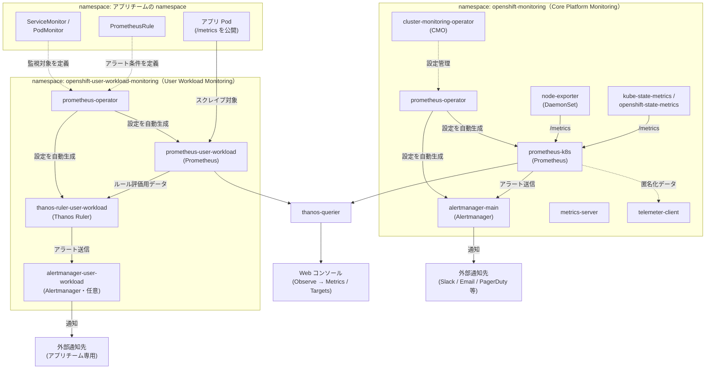

# OpenShift Monitoring アーキテクチャ（稼働 Pod 解説）

OpenShift のモニタリングスタックは、クラスター基盤自体を監視する **コアプラットフォーム監視（Cluster Monitoring）** と、ユーザーのアプリケーションを監視する **ユーザーワークロード監視（User Workload Monitoring: UWM）** の2つの領域に分かれており、それぞれ専用のネームスペース（プロジェクト）で Pod 群が稼働しています。

このドキュメントでは、それぞれの機能で稼働する主な Pod（コンポーネント）とその役割、および各コンポーネント間のデータの流れを整理します。構築・適用手順は [README.md](README.md) を参照してください。

## 全体図

- 実線（`-->`）はメトリクス・設定・アラートの **能動的な送信/生成** を、点線（`-.->`）は **CRD の監視・制御** や **間接的なデータ連携** を表します。
- `thanos-querier` が両ネームスペースの Prometheus を横断してクエリできるため、Web コンソールの `Observe` 画面ではプラットフォームのメトリクスとアプリケーションのメトリクスを同じ画面で確認できます。

---

## 1. クラスターモニタリング機能（Core Platform Monitoring）

**ネームスペース:** `openshift-monitoring`

クラスターのノード、コントロールプレーン、インフラサービスの健全性を監視するためのコアコンポーネント群です。

- **`prometheus-k8s`（Prometheus）**
  プラットフォーム基盤のメトリクス（CPU、メモリ、ネットワーク、Kubernetes コンポーネントの状態など）を収集・保存・評価する時系列データベースです。

- **`alertmanager-main`（Alertmanager）**
  プラットフォーム側で発報されたアラートを受信し、重複排除・グループ化を行い、外部システム（Slack、メール、PagerDuty など）へ通知をルーティングします。

- **`thanos-querier`（Thanos Querier）**
  コア監視とユーザーワークロード監視の両方のメトリクスを透過的に照会（PromQL クエリ）し、Web コンソールなどで一括可視化するためのクエリエンジンです。

- **`cluster-monitoring-operator`（CMO）**
  モニタリングスタック全体のデプロイ、設定管理（`cluster-monitoring-config` など）、ライフサイクル全般を中央制御・維持するオペレーターです。

- **`prometheus-operator`**
  `ServiceMonitor` や `PrometheusRule` などのカスタムリソース（CRD）を監視し、Prometheus や Alertmanager の設定ファイルを自動的に生成・更新します。

- **`node-exporter`（DaemonSet）**
  各ノード上で動作し、OS およびハードウェアレベルのメトリクス（CPU 使用率、メモリ空き容量、ディスク I/O、ネットワークトラフィックなど）を収集します。

- **`kube-state-metrics` / `openshift-state-metrics`**
  Kubernetes / OpenShift 内のオブジェクト（Pod、Deployment、Node、Namespace など）の現在の状態を監視し、メトリクスとして出力します。

- **`metrics-server`**
  `oc top` コマンドや HPA（Horizontal Pod Autoscaler）などで参照される、リアルタイムの軽量な CPU/メモリリソース使用量を収集・提供します。

- **`telemeter-client`**
  匿名化されたクラスターの健全性・規模データを Red Hat 側のテレメトリーサービスへ安全に送信します（有効な場合）。

## 2. ユーザーワークロード監視機能（User Workload Monitoring: UWM）

**ネームスペース:** `openshift-user-workload-monitoring`

ユーザーが作成したプロジェクト（アプリケーション）のメトリクス収集やアラート評価を、コア監視に影響を与えずに安全に行うための専用コンポーネント群です。

- **`prometheus-user-workload`（Prometheus）**
  ユーザープロジェクトの Pod や Service からメトリクスを収集・保存します。コア監視の `prometheus-k8s` と分離されているため、ユーザーのメトリクス急増が基盤監視に悪影響を及ぼしません。

- **`thanos-ruler-user-workload`（Thanos Ruler）**
  ユーザー定義のアラートルール（`PrometheusRule`）を評価し、評価結果に基づいたアラートを発報します。複数のプロジェクトを跨ぐアラートルール（Cross-project alerting）の評価も担当します。

- **`prometheus-operator`**
  `openshift-user-workload-monitoring` ネームスペース内で動作し、UWM 用の Prometheus や Thanos Ruler の自動構成とライフサイクル管理を行います。

- **`alertmanager-user-workload`（Alertmanager・オプション）**
  ユーザーワークロード用のアラート通知をプラットフォーム用と分離して独自にルーティングしたい場合に有効化される、ユーザー専用の Alertmanager インスタンスです。

---

## まとめ

このように OpenShift では、基盤監視（`openshift-monitoring`） と アプリケーション監視（`openshift-user-workload-monitoring`） で Pod やデータストアが完全に分離されており、マルチテナンシーと安定性を考慮したアーキテクチャになっています。

本リポジトリの構築手順（永続化設定・StorageClass 確認・OCI のゾーンラベル事前確認など）は [README.md](README.md) を、アプリチーム向けの監視追加手順（ServiceMonitor / PrometheusRule のサンプル）は [user-workload-monitoring/sample-app](user-workload-monitoring/sample-app) を参照してください。
